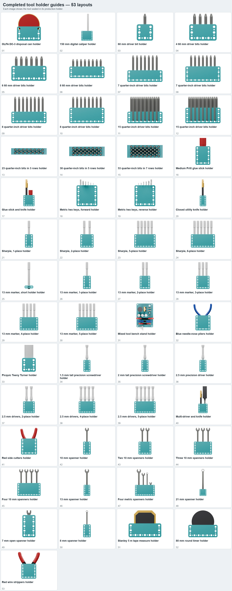

# Completed tool models and guides

53 completed holder layouts. Guide counts overlap where a holder contains more than one tool; they are not quantities of physical tools.

| Tool | Finished holder guides | Example guide |
| --- | ---: | --- |
| 1.5 mm metric hex key | 3 | [View holder](../../parts/oobb_part_holder_tool_hex_key_small_metric_set_6_forward_5x5x8/README.md#assembly) |
| 2 mm metric hex key | 3 | [View holder](../../parts/oobb_part_holder_tool_hex_key_small_metric_set_6_forward_5x5x8/README.md#assembly) |
| 2.5 mm metric hex key | 3 | [View holder](../../parts/oobb_part_holder_tool_hex_key_small_metric_set_6_forward_5x5x8/README.md#assembly) |
| 3 mm metric hex key | 3 | [View holder](../../parts/oobb_part_holder_tool_hex_key_small_metric_set_6_forward_5x5x8/README.md#assembly) |
| 4 mm metric hex key | 3 | [View holder](../../parts/oobb_part_holder_tool_hex_key_small_metric_set_6_forward_5x5x8/README.md#assembly) |
| 5 mm metric hex key | 2 | [View holder](../../parts/oobb_part_holder_tool_hex_key_small_metric_set_6_forward_5x5x8/README.md#assembly) |
| Picquic Teeny Turner precision multi-driver | 1 | [View holder](../../parts/oobb_part_holder_tool_screwdriver_picquic_teeny_turner_1_place_3x3x31/README.md#assembly) |
| Quarter-inch drive bit | 9 | [View holder](../../parts/oobb_part_holder_tool_driver_bit_quarter_inch_7_place_9x3x12/README.md#assembly) |
| Sharpie-style felt-tip pen, 13 × 137 mm | 6 | [View holder](../../parts/oobb_part_holder_tool_marker_sharpie_style_13mm_1_place_3x1x17/README.md#assembly) |
| Closed utility knife, 17 mm | 4 | [View holder](../../parts/oobb_part_holder_tool_glue_stick_prit_medium_with_knife_5x5x30/README.md#assembly) |
| OLFA DC-3 blade disposal can | 1 | [View holder](../../parts/oobb_part_holder_tool_blade_disposal_olfa_dc3_1_place_5x3x29d5/README.md#assembly) |
| Sharpie standard-tip marker, 13 × 137 mm | 5 | [View holder](../../parts/oobb_part_holder_tool_marker_sharpie_1_place_3x5x15/README.md#assembly) |
| Mitutoyo 500-196-30 digital caliper, 150 mm | 1 | [View holder](../../parts/oobb_part_holder_tool_caliper_mitutoyo_500_196_30_1_place_7x6x18/README.md#assembly) |
| Stanley 1-30-696 tape measure, 5 m | 1 | [View holder](../../parts/oobb_part_holder_tool_tape_measure_stanley_1_30_696_1_place_7x3x44/README.md#assembly) |
| Blue needle-nose pliers, 130 mm | 2 | [View holder](../../parts/oobb_part_holder_tool_mixed_tools_basic_stand_bench_7x10x66/README.md#assembly) |
| Driver bit, 60 mm profile | 4 | [View holder](../../parts/oobb_part_holder_tool_driver_bit_driver_bit_60mm_1_place_3x3x10/README.md#assembly) |
| Tall precision hex screwdriver, 1.5 × 60 mm | 2 | [View holder](../../parts/oobb_part_holder_tool_mixed_tools_basic_stand_bench_7x10x66/README.md#assembly) |
| Tall precision hex screwdriver, 2 × 60 mm | 2 | [View holder](../../parts/oobb_part_holder_tool_mixed_tools_basic_stand_bench_7x10x66/README.md#assembly) |
| Tall precision hex screwdriver, 2.5 × 60 mm | 5 | [View holder](../../parts/oobb_part_holder_tool_mixed_tools_basic_stand_bench_7x10x66/README.md#assembly) |
| Quikpik multi-driver, 200 mm | 2 | [View holder](../../parts/oobb_part_holder_tool_mixed_tools_basic_stand_bench_7x10x66/README.md#assembly) |
| Red side cutters, 110 mm | 2 | [View holder](../../parts/oobb_part_holder_tool_mixed_tools_basic_stand_bench_7x10x66/README.md#assembly) |
| Medium Prit glue stick | 2 | [View holder](../../parts/oobb_part_holder_tool_glue_stick_prit_medium_1_place_4x5x30/README.md#assembly) |
| Round black timer, 80 × 30 mm | 1 | [View holder](../../parts/oobb_part_holder_tool_timer_round_80mm_1_place_7x3x34/README.md#assembly) |
| Red wire strippers, 120 mm | 2 | [View holder](../../parts/oobb_part_holder_tool_mixed_tools_basic_stand_bench_7x10x66/README.md#assembly) |
| M10 spanner | 6 | [View holder](../../parts/oobb_part_holder_tool_mixed_tools_basic_stand_bench_7x10x66/README.md#assembly) |
| M13 spanner | 2 | [View holder](../../parts/oobb_part_holder_tool_spanner_m13_1_place_3x5x10/README.md#assembly) |
| M21 spanner | 1 | [View holder](../../parts/oobb_part_holder_tool_spanner_m21_1_place_5x5x12/README.md#assembly) |
| M7 spanner | 3 | [View holder](../../parts/oobb_part_holder_tool_mixed_tools_basic_stand_bench_7x10x66/README.md#assembly) |
| M8 spanner | 3 | [View holder](../../parts/oobb_part_holder_tool_mixed_tools_basic_stand_bench_7x10x66/README.md#assembly) |

The remaining tool evidence and layouts are listed in [OUTSTANDING.md](OUTSTANDING.md).
